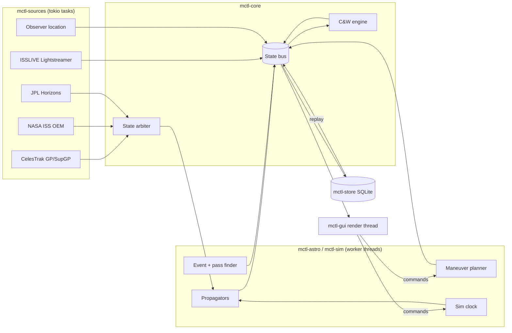

# mctl — Mission Control Display: Requirements and Design

**Status:** Draft 1 · 2026-10-23
**Owner:** Liam Droog
**Scope:** v1 (ISS-first, multi-vehicle architecture), with v2+ items marked

---

## 1. Overview

`mctl` is a desktop application styled after a NASA mission control console. It displays near-real-time trajectory, attitude, and subsystem data for crewed and uncrewed spacecraft, starting with the ISS. It renders a character-grid "console" UI with embedded GPU-rendered graphical panels (3D orbit map, ADI, sky plot, etc.) and includes a simulation clock and an impulsive maneuver planner.

It is a single Rust binary launched with one command (`mctl`). It is a GUI application that looks and behaves like a terminal console; a terminal (TUI) front end is a later, secondary deliverable.

### 1.1 Goals

- G1. Display the best publicly available state of a vehicle, from the most current source, with the data's age, source, and estimated accuracy always visible.
- G2. Look and feel like a flight control console: dense, organized, keyboard-driven, with a master page and subsystem pages.
- G3. Propagate and render faster than the data arrives (≥ 50 Hz state, 60 fps display).
- G4. Allow "what-if" trajectory work: time warp/scrub and an impulsive maneuver planner with numerical propagation.
- G5. Support additional vehicles and data sources through a pluggable source layer without UI changes.

### 1.2 Non-goals

- Operational use. Public data is filtered, delayed, and lower fidelity than what flight controllers see. The application must never present itself as ops-grade.
- Commanding, uplink, or anything that transmits to a spacecraft.
- Finite-burn modeling, targeting solvers (Lambert, phasing, rendezvous) — v2 at the earliest.
- Mobile or web targets.

### 1.3 Honesty rule (applies to every requirement below)

If a value is not available from a source, the UI shows `NO DATA` / `OFF`, never a plausible-looking substitute. Derived values are labelled with their source. Predicted values are visually distinct from measured or reported values.

---

## 2. Vehicles and capability matrix (v1 target set)

| Vehicle | ID | Trajectory source(s) | Attitude | Subsystem TLM | Primary views |
|---|---|---|---|---|---|
| ISS | NORAD 25544 | NASA OEM (primary), CelesTrak GP/SGP4 (fallback) | ISSLIVE (TBC) | ISSLIVE | All |
| Hubble | NORAD 20580 | CelesTrak GP/SGP4 | None | None | Traj, Pass, Window |
| Crew/Cargo Dragon | Per mission (CelesTrak lookup by name/INTDES) | CelesTrak GP/SGP4; when docked, ISS state | None | None | Traj, Pass, Prox |
| JWST | Horizons `-170` | JPL Horizons vectors | None | None | L2 view, Elements |
| Roman | Horizons ID TBC | JPL Horizons vectors | None | None | L2 view (cruise/halo), Elements |

Notes:
- Roman launched 2026-08-30 on Falcon Heavy and is in transit to Sun–Earth L2. Its Horizons ID and ephemeris availability must be confirmed in M6.
- Dragon NORAD IDs change per mission. Vehicle definitions resolve by name or international designator at startup and cache the resolved ID.
- Pages a vehicle has no data for are shown greyed out with the reason (`NO SOURCE`), not hidden. This keeps the layout stable across vehicles.

---

## 3. Data sources

### 3.1 Source inventory

| Source | Provides | Frame / format | Update cadence | Auth | Status |
|---|---|---|---|---|---|
| **NASA ISS OEM** (`nasa-public-data.s3.amazonaws.com/iss-coords/current/ISS_OEM/ISS.OEM_J2K_EPH.{txt,xml}`) | ISS state vectors at 4-min spacing, ~15 days of prediction, planned maneuvers and post-maneuver vectors in the comment block, mass and drag data | CCSDS OEM, Mean of J2000 (EME2000) | Reposted by TOPO when the trajectory changes | None | Verified URL; parse comment block format in M1 |
| **CelesTrak GP** (`celestrak.org/NORAD/elements/gp.php`) | Mean elements for SGP4 | OMM JSON (preferred), TLE | ~Several per day per object | None | Verified; default format is CSV since 2026-05, so always request `FORMAT=JSON` explicitly |
| **CelesTrak SupGP** (`.../supplemental/sup-gp.php`) | Operator-derived elements fitted forward from current epoch (includes `ISS-E`, `SpaceX-E`) | OMM JSON | Varies | None | Evaluate in M1 as a better SGP4 source than standard GP for ISS and Dragon |
| **Space-Track** | GP history, decay, conjunction data | OMM | — | Account required | v2, optional |
| **ISSLIVE** (Lightstreamer, `push.lightstreamer.com`, adapter `ISSLIVE`) | Real-time public ISS telemetry: attitude, CMGs, power, thermal, ECLSS, comm, joint angles | Lightstreamer TLCP item/field updates | Push, per-item change | None | Community-sustained (ISS Mimic). Item IDs taken from ISS Mimic's published list; attitude item IDs and frame **to be verified in M3** |
| **JPL Horizons API** (`ssd.jpl.nasa.gov/api/horizons.api`) | Ephemeris vectors for JWST, Roman, Sun, Moon | `EPHEM_TYPE=VECTORS`, ICRF | On request (cache) | None | Verified |
| **Observer location** | Site lat/lon/alt | — | Startup | — | See §8 |

### 3.2 Source arbitration

Each vehicle has an ordered list of trajectory sources. The **state arbiter** selects the active source per vehicle using:

1. **Health:** reachable, parsed, not stale beyond the source's configured limit.
2. **Validity window:** the requested time falls within the source's span. OEM covers about −1 to +15 days; SGP4 is valid everywhere but degrades.
3. **Priority:** configured order (ISS default: OEM → SupGP → GP).

All non-active trajectory sources keep propagating in the background. The arbiter publishes **inter-source residuals** (Δr, Δv in RTN), for example `OEM vs SGP4`. A residual above threshold raises a caution. This is the primary indicator that a TLE is stale after a reboost.

### 3.3 Fetch policy

- All HTTP fetches are cached on disk with ETag/Last-Modified. Minimum refresh intervals are configurable, with polite defaults: CelesTrak GP no more than once per 2 h per object, OEM every 30 min, Horizons once per 6 h.
- Fetches respect each provider's usage policy. No retry storms: exponential backoff with jitter, capped.
- On startup the app runs from cache immediately and refreshes in the background. With no network it runs from cache and flags data age.

---

## 4. Functional requirements

IDs are stable; `[v1]` is in scope for the first release, `[v2]` is deferred.

### 4.1 Data and state

- FR-1 `[v1]` Fetch, parse, and cache CelesTrak GP (OMM JSON) for configured vehicles.
- FR-2 `[v1]` Fetch and parse the NASA ISS OEM, including planned maneuver events from the comment block. Interpolate state at arbitrary times (§6.3).
- FR-3 `[v1]` Connect to ISSLIVE, subscribe to a configured item list, and publish values with receive timestamps.
- FR-4 `[v1]` Fetch JPL Horizons vectors for configured deep-space vehicles and interpolate.
- FR-5 `[v1]` Arbitrate trajectory sources per §3.2 and publish inter-source residuals.
- FR-6 `[v1]` Every displayed value carries source, epoch/age, and quality (`LIVE`, `PRED`, `SIM`, `STALE`, `NO DATA`).

### 4.2 Astrodynamics

- FR-10 `[v1]` SGP4/SDP4 propagation from OMM.
- FR-11 `[v1]` Frame transformations: TEME ↔ GCRF/EME2000 ↔ ITRF (geodetic), plus LVLH, RTN, and VNB local frames.
- FR-12 `[v1]` Osculating classical elements, apsis altitudes, period, and beta angle from state.
- FR-13 `[v1]` Sun and Moon position (analytic, arcminute-level is sufficient), eclipse entry/exit (conical shadow model).
- FR-14 `[v1]` Event detection: AN/DN, apsides, eclipse in/out, observer AOS/TCA/LOS, maximum elevation.
- FR-15 `[v1]` Pass prediction for each configured observer site, 7 days ahead, with elevation mask.
- FR-16 `[v1]` Numerical propagator with configurable force models (§7).

### 4.3 Simulation clock

- FR-20 `[v1]` A single sim clock drives all displays. Modes: `LIVE` (wall clock, rate 1×), `SIM` (any rate from −10000× to +10000×, pause, step), and `REPLAY` (recorded history).
- FR-21 `[v1]` Scrub to an arbitrary epoch. Future epochs use predicted sources; past epochs use recorded history, falling back to OEM, then SGP4.
- FR-22 `[v1]` Return to `LIVE` with one key.
- FR-23 `[v1]` Live telemetry panels show `NOT LIVE` whenever the clock is not in `LIVE` mode, unless replaying recorded telemetry.

### 4.4 Maneuver planner

- FR-30 `[v1]` Define one or more impulsive burns. Each burn has a trigger (absolute epoch, or next AN/DN/apoapsis/periapsis after a reference time), a frame (VNB or RTN), and a Δv vector.
- FR-31 `[v1]` Propagate the post-burn trajectory numerically (§7) and overlay it, along with the nominal trajectory, on the orbit map and ground track.
- FR-32 `[v1]` Report Δ elements, new apsis altitudes, Δ period, Δ phase at a chosen epoch, and shifted observer pass times.
- FR-33 `[v1]` Import planned maneuvers from the ISS OEM as read-only reference burns where the comment data supports it.
- FR-34 `[v1]` Save and load maneuver plans (TOML).
- FR-35 `[v2]` Finite burns, targeting solvers.

### 4.5 Caution and warning (C&W)

- FR-40 `[v1]` A rule engine evaluates limits on any published value. Rules are defined in TOML: thresholds, hysteresis, persistence time, and severity.
- FR-41 `[v1]` Severities: `NOM`, `CAUT`, `WARN`, plus data-quality states `STALE` and `NO DATA`.
- FR-42 `[v1]` A master caution/warning annunciator latches until acknowledged (`A`). An event log records every transition.
- FR-43 `[v1]` Default rules cover TLE age, inter-source residual, live feed loss, data staleness, conjunction (v2, Space-Track), and selected ISSLIVE subsystem limits. ISS subsystem limits are **user-defined**; public flight-rule limits are not assumed.

### 4.6 Observer site

- FR-50 `[v1]` Resolve the default observer site via the chain in §8. Display the resolved source and uncertainty.
- FR-51 `[v1]` Maintain a list of named sites in config. One site is active; the pass page can show all sites.

### 4.7 Persistence and replay

- FR-60 `[v1]` Record arbiter output (per vehicle, per source, at a configurable rate, default 1 Hz), all live telemetry, C&W events, and every fetched GP/OEM element set, in a local SQLite database.
- FR-61 `[v1]` Retention policy is configurable by age and size.
- FR-62 `[v1]` Export a time range to CSV or HDF5 (HDF5 behind a cargo feature; see §10).
- FR-63 `[v1]` Replay mode drives all pages from recorded data.

### 4.8 UI

See §9 for the full specification.

- FR-70 `[v1]` Four themes: Phosphor (P1 green), Retro (P3 amber), Modern, Retrowave. Switchable at runtime.
- FR-71 `[v1]` Fully keyboard-driven, with mouse support for camera control and selection.
- FR-72 `[v1]` Command line (`:`) for all actions, with completion.
- FR-73 `[v1]` Page map per §9.4.

### 4.9 TUI front end

- FR-80 `[v2]` `mctl --tui`: a ratatui front end consuming the same core, with text panels and minimal graphics.

---

## 5. Non-functional requirements

| ID | Requirement |
|---|---|
| NFR-1 | Single executable. Runtime dependencies are limited to the system GPU stack (Vulkan or GL via wgpu) and libc. All assets (fonts, Earth textures, coastlines) are embedded. |
| NFR-2 | 60 fps display at 2560×1440 on integrated graphics (Intel Xe-class) with all panels of the master page visible. |
| NFR-3 | Core state update ≥ 50 Hz per active vehicle. Rendering is decoupled from data. |
| NFR-4 | Cold start to first rendered frame from cache in under 2 s. |
| NFR-5 | Network loss never blocks the UI thread. Every source runs in its own supervised task. |
| NFR-6 | Primary platform: Kubuntu (current LTS), X11 and Wayland. Windows should build without code changes but is not tested in v1. |
| NFR-7 | No telemetry or analytics. The only outbound calls are to configured data sources, plus IP geolocation if explicitly enabled. |
| NFR-8 | All tunables (URLs, rates, thresholds, colours, keybindings) are in config, not hardcoded. |
| NFR-9 | Dependencies are pinned (`Cargo.lock` committed, minimal semver ranges in `Cargo.toml`). |

---

## 6. Architecture

### 6.1 Workspace layout

```
mctl/
├── Cargo.toml                (workspace)
├── crates/
│   ├── mctl-core/            time, frames, state types, bus, arbiter, C&W engine
│   ├── mctl-astro/           SGP4 wrapper, numerical propagator, events, passes, sun/moon
│   ├── mctl-sources/         CelesTrak, OEM, ISSLIVE, Horizons, geolocation adapters
│   ├── mctl-store/           SQLite recording, retention, export, replay reader
│   ├── mctl-sim/             sim clock, maneuver planner
│   ├── mctl-gui/             winit + wgpu + egui front end, renderers, themes
│   └── mctl-tui/             [v2] ratatui front end
├── assets/                   fonts, textures, coastlines (embedded at build)
├── config/                   default config, C&W rules, vehicle definitions
└── src/main.rs               CLI entry point → mctl-gui (or mctl-tui)
```

`mctl-core` has no UI, network, or async-runtime dependency, so it is unit-testable in isolation.

### 6.2 Runtime model



- **Async I/O:** a tokio runtime on a dedicated thread pool for sources only.
- **Compute:** the propagation tick runs on its own thread at 50 Hz (configurable). The tick reads the sim clock and evaluates every vehicle's active and background sources. Event and pass searches and maneuver propagation run on a rayon pool and post results to the bus asynchronously.
- **State bus:** a lock-free snapshot model (`arc-swap` of an immutable `World` snapshot), published per tick. The GUI reads the latest snapshot each frame; it never blocks the producers. Telemetry and events go through bounded channels into the snapshot builder.
- **Commands:** GUI → core via a command channel (`SetRate`, `Seek`, `AddBurn`, `Ack`, …). The core never calls into the GUI.

### 6.3 Time

- Internal timescale: TAI, as i64 seconds plus f64 fractional seconds or an equivalent representation that avoids precision loss over decades. Conversions to UTC (leap-second table embedded and updatable from IERS), TT, and UT1.
- UT1−UTC: from IERS `finals2000A` if cached; otherwise assume 0 and flag it. The effect is at most about 0.9 s, or roughly 400 m of ground-track error at the equator; acceptable, but displayed.
- Display: GMT as `DDD:HH:MM:SS.ss` (day of year), plus optional MET relative to a configured vehicle epoch.

### 6.4 Reference frames

| Frame | Use |
|---|---|
| TEME | SGP4 output only. Converted immediately. |
| GCRF / EME2000 | Internal inertial frame. The ~mas frame bias between them is ignored and documented. |
| ITRF | Ground track, observer geometry. Polar motion is ignored (~10 m). |
| LVLH | ADI reference and prox-ops (Hill frame for relative motion). |
| RTN / VNB | Maneuver input, residual reporting. |
| Sun–Earth synodic (rotating) | L2 view. |

### 6.5 Library choices

| Need | Candidate | Decision point |
|---|---|---|
| SGP4 | `sgp4` crate (pure Rust, OMM support) | Adopt unless M0 evaluation picks a full astro library |
| Frames, numerical propagation, force models | `satkit` or `brahe` (both Rust astrodynamics libraries), versus in-house | **M0 evaluation:** feature coverage, accuracy against references, license, maintenance |
| Linear algebra | `nalgebra` | Adopt |
| HTTP | `reqwest` + `rustls` | Adopt (no OpenSSL, preserves NFR-1) |
| Lightstreamer TLCP | `lightstreamer-rs` (evaluate) / `lightstreamer-client` (GPL-3.0, partial implementation) / in-house minimal TLCP over WebSocket | License decides (see §14). In-house is the fallback: the protocol subset needed (create session, subscribe MERGE items, parse updates) is small |
| Windowing / GPU | `winit` + `wgpu` | Adopt |
| Immediate-mode UI | `egui` with `egui-winit` + `egui-wgpu` (not `eframe`) | Adopt. A custom loop is required so egui renders to an offscreen target for the CRT post-pass |
| SQLite | `rusqlite` with `bundled` | Adopt |
| Config | `serde` + `toml`, `directories` for XDG paths | Adopt |
| CLI | `clap` | Adopt |
| Logging | `tracing` + `tracing-subscriber` (file sink) | Adopt |

---

## 7. Astrodynamics design

### 7.1 Propagators

| Propagator | Use | Notes |
|---|---|---|
| SGP4/SDP4 | GP elements; always-on fallback | Evaluated every tick |
| OEM interpolation | ISS primary | Lagrange (or Hermite, position and velocity), 8th order, as recommended in the OEM header. Segment boundaries at maneuvers must not be interpolated across. |
| Horizons interpolation | Deep-space vehicles | Cache vectors at 1 h spacing; Hermite interpolation |
| Numerical (Cowell) | Maneuver planner, sim extension beyond source spans | Adaptive Dormand–Prince 8(7) (or RKF7(8)). Forces: two-body, J2–J4 zonal, Sun and Moon third body (toggle), atmospheric drag (exponential or Harris–Priester; NRLMSISE-00 in v2), cannonball SRP (for HEO/L2, toggle). Ballistic coefficient defaults from OEM header (ISS) or config. |

### 7.2 Accuracy budget (indicative, displayed in the UI)

| Source | Typical position error | Displayed as |
|---|---|---|
| ISS OEM, near term, no unmodelled maneuver | Sub-km to a few km over days (drag-dominated) | `PRED (OEM)` with age |
| SGP4 from fresh GP, LEO | ~1 km at epoch, growing a few km per day | `PRED (SGP4)` with TLE age |
| SGP4 after an unpublished maneuver | Unbounded until a new element set | Caught by the residual caution |
| Horizons (JWST) | Depends on JPL's predict | `PRED (HZN)` with fetch age |
| Numerical (planner) | Dominated by drag-model uncertainty | `SIM` |

These numbers are order-of-magnitude guidance for the operator. They are not validated error bounds; validation is in §12.

### 7.3 Events and passes

- Root finding (Brent) on sampled event functions: elevation − mask, shadow function, argument of latitude mod π, radial velocity.
- Sample step adapts to orbit period (default period/200) so short passes are not missed.
- Results are cached per (vehicle, source epoch) and invalidated when the active source changes or a maneuver plan changes.

### 7.4 Maneuver planner

1. The burn list is sorted by resolved epoch. Trigger resolution (e.g. "next apoapsis after T") runs on the nominal trajectory.
2. Initial state comes from the active source at the first burn epoch, or the current epoch if earlier.
3. Propagate numerically to each burn, apply Δv in the specified local frame, and continue to the plan horizon (default 3 revolutions; max 7 days).
4. Nominal comparison: the same numerical propagator without burns, from the same initial state. This isolates the burn's effect from SGP4-versus-numerical model differences.
5. Outputs are published on the bus as a `PlannedTrajectory` with per-burn markers.

---

## 8. Observer location

Resolution chain; the first success wins, and the winning source is shown:

1. **Configured site:** `[observer] active = "<name>"` with explicit lat, lon, alt.
2. **GeoClue2 (D-Bus):** request accuracy level `CITY`, timeout 3 s. The WiFi backend has depended on providers that have been retired (Mozilla Location Service shut down in 2024), so results vary by distro configuration. Best-effort only.
3. **IP geolocation:** **disabled by default.** When enabled, queries a configured HTTPS endpoint once per session; results are cached. City-level accuracy (typically 10–50 km).
4. **Fallback:** NASA Headquarters, 300 E St SW, Washington DC — 38.8830° N, 77.0163° W, 10 m (verify coordinates against a survey source before release).

The UI shows the site as, for example, `SITE YYC (GEOCLUE ±5 km)` or `SITE NASA HQ (DEFAULT)`. A one-key action (`:site save`) persists the current resolution as a configured site.

---

## 9. UI design

### 9.1 Rendering model

- One window, rendered as a fixed **character grid**. Default cell size comes from the theme font at the configured point size; the grid reflows on resize. All text-based panels draw into the grid.
- **Graphical panels** are rectangular regions of the grid rendered by dedicated wgpu passes (globe, ADI, plots) into offscreen textures, then composited into their grid rectangles.
- **Post-processing pass (theme-dependent):** scanlines, phosphor bloom/glow, subtle curvature and vignette, persistence (frame blending for phosphor decay). All effects can be toggled individually; Modern disables them by default.

### 9.2 Themes

| Theme | Palette | Limit-state encoding | Post effects |
|---|---|---|---|
| Phosphor | P1 green monochrome | CAUT: inverse video. WARN: inverse plus 2 Hz blink. STALE: dim. | Scanlines, bloom, persistence |
| Retro | P3 amber monochrome | Same as Phosphor | Scanlines, bloom, persistence |
| Modern | Dark slate, semantic colours (green/amber/red/cyan) | Colour plus label | None (crisp) |
| Retrowave | Deep purple, magenta/cyan, horizon grid accents | Colour plus label | Bloom, optional grid backdrop |

Themes are TOML files (palette, font, effect parameters). Users can add their own. Every theme must encode limit states with something other than hue alone (inverse video, a label, or blink).

Fonts (embedded, OFL or public domain, licenses checked in M0): a crisp monospace for Modern and a CRT-style bitmap-look monospace for the retro themes.

### 9.3 Global chrome

- **Header (row 1):** vehicle and ID, page name, GMT, MET, sim clock mode and rate, active source with data age, site, master C&W annunciator.
- **Footer (last row):** function-key legend for the current page, command line when `:` is active.

### 9.4 Page map

| Key | Page | Sub-pages (Tab cycles) |
|---|---|---|
| F1 | MASTER | — |
| F2 | TRAJ | Orbit map 3D · Ground track · Elements and trends · Maneuver planner |
| F3 | GNC | ADI · Rates and errors · CMG momentum (ISS) |
| F4 | EPS | Arrays/SARJ · Batteries and buses (ISS) |
| F5 | TCS/ECLSS | Loops and radiators · Atmosphere (ISS) |
| F6 | COMM | Links and AOS/LOS · TDRS coverage [v2] |
| F7 | PASS | Sky plot · Pass list · Sites |
| F8 | PROX | R-bar/V-bar (when a visiting vehicle is defined) |
| F9 | VIEW | Window view (nadir / limb / free) |
| F10 | SYS | Event log · Source health · Settings |
| — | L2 | Replaces F2 orbit map for Sun–Earth L2 vehicles |

### 9.5 MASTER page

Layout at a 200×56 grid (reference size; panels reflow at smaller sizes, minimum 160×45):

```
┌ HEADER ─────────────────────────────────────────────────────────────────────────────────────┐
├ ORBIT MAP (gfx, mini) ────────┬ STATE VECTOR (ECI/ECEF toggle) ┬ CAUTION & WARNING ─────────┤
│                               ├ ELEMENTS (osculating)          │                            │
│                               │                                ├ SOURCES (health, age, Δ)   │
├ GROUND TRACK (gfx) ───────────┴────────────────────────────────┼ ECLIPSE / BETA CLOCK (gfx) ┤
│                                                                │                            │
├ EVENT TIMELINE ────────────────────────────┬ SUBSYSTEM SUMMARY ┴────────────────────────────┤
├ FOOTER ─────────────────────────────────────────────────────────────────────────────────────┘
```

### 9.6 View specifications

**Orbit map (F2.1)**
- Shaded Earth: day/night terminator from Sun vector, optional city lights at night, coastlines and graticule overlay, atmosphere limb. Rotates with ERA/GMST.
- Camera: orbit (arrow keys or drag), zoom (+/− or wheel). Frames: inertial (default) or Earth-fixed. Focus on the vehicle or on Earth.
- Overlays: past track (solid), predicted orbit for +N revs (dashed), planned trajectory (distinct style), AN/DN, Ap/Pe markers with altitudes, velocity vector, nadir line, Sun direction, eclipse segment highlighted on the orbit.
- Scale: true by default. Altitude exaggeration (×1, ×2, ×5, ×10) is always labelled in the panel header.
- Occlusion: orbit segments behind Earth are hidden. The vehicle marker switches to a hollow `OCCULTED` style when behind Earth.

**Ground track (F2.2)**
- Equirectangular, with optional Robinson/Mercator. Day/night shading, past and future tracks (±N revs), observer sites with visibility circles at the current altitude and mask, sub-solar point.

**Elements and trends (F2.3)**
- Time-series plots from the store: semi-major axis, altitude (ha, hp), e, i, RAAN, argument of perigee, beta, and inter-source residual. Selectable window (6 h – 90 d). GP element-set epochs are marked, showing reboosts as steps.

**Maneuver planner (F2.4)**
- Burn table: #, trigger, epoch, frame, Δv components and magnitude.
- Controls: force-model toggles, horizon, ballistic coefficient.
- Results: Δ elements, new Ha/Hp, Δ period, Δ phase at a chosen epoch, pass-time shifts for the active site. The planned trajectory is overlaid on F2.1 and F2.2.

**ADI (F3.1)**
- Shaded 8-ball with sky/ground split, pitch ladder (10° increments), heading meridians, roll scale with pointer, fixed vehicle symbol, rate and error needles.
- Reference frame selectable: LVLH (default) or inertial (J2000).
- Data: ISSLIVE attitude (item IDs and frame TBC in M3). With no attitude source, the ball is replaced by an `OFF` flag; no attitude is synthesized.
- The ISS normally holds a near-fixed LVLH attitude, so in practice the ball barely moves. That is correct behaviour, not a defect.

**Sky plot (F7.1)**
- Polar azimuth/elevation plot for the active site: elevation rings at 0/30/60, mask contour, next pass arc (predicted dashed, flown solid), current position, AOS/TCA/LOS labels, Sun position, and whether the vehicle is sunlit (for visual passes).

**Prox-ops (F8)**
- Hill-frame (LVLH) relative motion of a visiting vehicle relative to the ISS: R-bar/V-bar axes, approach ellipsoid, keep-out sphere, approach corridor (dimensions configurable; public values to be sourced), and relative trajectory history and prediction.
- A permanent `TLE-DERIVED — NOT VALID INSIDE ~5 KM` banner unless both vehicles have ephemeris-grade sources.

**L2 view (JWST/Roman)**
- Sun–Earth rotating frame centred at L2 or Earth (toggle): Earth–Sun line fixed, Moon orbit, vehicle trail and prediction, halo orbit projections in XY/XZ/YZ.

**Window view (F9)**
- Perspective render from the vehicle: Earth limb with correct curvature for altitude, terminator, clouds off (static texture), sub-satellite point marker, Sun and Moon. Camera directions: nadir, ram, wake, or free-look.

**Eclipse/beta clock (MASTER)**
- A ring representing one revolution, with the sunlit/eclipse arc and the current position, plus a beta angle sparkline over ±30 days.

### 9.7 Input

| Key | Action |
|---|---|
| F1–F10 | Page |
| Tab / Shift-Tab | Sub-page |
| V | Cycle vehicle |
| Space | Pause/resume sim clock |
| `[` / `]` | Halve/double warp rate |
| 0 | Return to LIVE |
| A | Acknowledge master C&W |
| T | Theme cycle |
| `:` | Command line (e.g. `:warp 60`, `:seek +2h`, `:burn add next-apo vnb 0.5 0 0`, `:site add yyc 51.05 -114.07 1045`) |
| ? | Help overlay for the current page |
| Q | Quit (with confirmation if a plan is unsaved) |

All bindings are remappable in config.

---

## 10. Persistence

SQLite (WAL mode) at `$XDG_DATA_HOME/mctl/mctl.db`.

| Table | Contents |
|---|---|
| `state` | vehicle, source, t_tai, frame, r[3], v[3], quality |
| `telemetry` | item_id, t_rx, t_src (if provided), value (REAL/TEXT) |
| `elements` | vehicle, source, epoch, raw OMM/OEM blob, fetched_at |
| `events` | t, vehicle, kind, payload (JSON) |
| `cw_log` | t, rule, from_state, to_state, value, acked_at |

Export: CSV always. HDF5 is behind a `hdf5` cargo feature, because linking `libhdf5` statically is non-trivial and conflicts with NFR-1 for the default build.

---

## 11. Configuration and CLI

- Config dir: `$XDG_CONFIG_HOME/mctl/` (`config.toml`, `vehicles.toml`, `cw_rules.toml`, `themes/*.toml`, `plans/*.toml`).
- Cache dir: `$XDG_CACHE_HOME/mctl/` (HTTP cache, Horizons vectors, IERS data).
- Missing config files are created from embedded defaults on first run. Invalid config fails loudly with file, line, and reason; no silent defaults for malformed values.

```
mctl                         launch GUI, default vehicle
mctl --vehicle hubble        launch on a vehicle
mctl --theme retrowave
mctl --replay 2026-10-20T00:00Z..2026-10-21T00:00Z
mctl --offline               cache only, no network
mctl export --from .. --to .. --format csv --out ./dump/
mctl check                   validate config and source connectivity, then exit
mctl --tui                   [v2]
```

---

## 12. Verification and validation

| Area | Method | Pass criterion |
|---|---|---|
| SGP4 | Vallado verification test vectors | Matches reference within published tolerance |
| Frames | Reference conversions (Vallado examples) for TEME→GCRF→ITRF | < 1 m, or document residual source |
| OEM interpolation | Hold out every other vector, interpolate, compare | < 10 m |
| Numerical propagator | Propagate ISS from an OEM vector for 24 h without maneuvers, compare with OEM | Residual reported; target < 1 km/24 h with drag tuned to OEM header values |
| Maneuver Δv application | Analytic Hohmann case (circular to elliptic) | Ha/Hp match analytic within 1 m |
| Passes | Compare 20 passes with NASA Spot the Station / an independent tool | AOS/LOS within 10 s, max elevation within 0.5° |
| Eclipse | Compare with eclipse events computed from OEM vectors with an independent tool | Within 5 s |
| Event detection | Synthetic orbits with known AN/DN/apsis times | Within 0.1 s |
| C&W | Unit tests per rule type (threshold, hysteresis, persistence, staleness) | All transitions as specified |
| Rendering | Smoke test renders each page headless to PNG in CI | No panic; image hash review on intentional changes |
| Performance | Frame-time capture on the target laptop | NFR-2, NFR-3 met |

---

## 13. Milestones

| # | Milestone | Exit criteria |
|---|---|---|
| M0 | **Spikes** | (a) winit+wgpu+egui window with a character grid, CRT post-pass, and a shaded globe at 60 fps. (b) Astro library evaluation (`satkit` / `brahe` / in-house) with a written decision. (c) ISSLIVE connection receiving at least one item via the chosen Lightstreamer approach. (d) Font and texture licenses confirmed. |
| M1 | Core and sources | Time and frames, SGP4, CelesTrak OMM, OEM ingest and interpolation, arbiter with residuals, store recording. `mctl check` works. |
| M2 | MASTER and TRAJ | MASTER page, orbit map, ground track, elements and trends, all four themes. |
| M3 | Live telemetry | ISSLIVE adapter, GNC/EPS/TCS/COMM pages, ADI, C&W engine and annunciator. |
| M4 | Passes | Observer chain, pass finder, sky plot, eclipse/beta clock. |
| M5 | Sim and planner | Sim clock (warp, scrub, replay), maneuver planner, OEM maneuver import. |
| M6 | Multi-vehicle | Hubble, Dragon, prox-ops page; JWST and Roman via Horizons; L2 view. |
| M7 | Window view and release | Window view, polish, packaging (release binary plus `.desktop` file), docs. |
| v2 | — | TUI front end, Space-Track and conjunctions, finite burns and targeting, NRLMSISE-00, TDRS coverage. |

---

## 14. Risks and open questions

| # | Item | Impact | Mitigation / decision needed |
|---|---|---|---|
| R1 | ISSLIVE is community-sustained and undocumented; it could change or stop | Subsystem pages and ADI go dark | Feed health is shown prominently; pages degrade to `NO DATA`; trajectory views do not depend on it |
| R2 | Lightstreamer crate licensing (`lightstreamer-client` is GPL-3.0) | Forces the project license, or in-house work | **Decide the project license.** If not GPL-compatible, implement minimal TLCP in-house (est. 1–2 days for the subset needed) |
| R3 | OEM comment-block maneuver format is not formally specified | FR-33 may be fragile | Parse defensively; fall back to showing raw comment text in the event log |
| R4 | Attitude item IDs and reference frame in ISSLIVE unverified | ADI could be wrong | M3 verification against a known attitude mode before the ADI is enabled |
| R5 | Integrated GPU performance with bloom and persistence at 1440p | NFR-2 | Effects at reduced internal resolution; per-effect toggles |
| R6 | Roman Horizons ID and ephemeris availability | Roman support | Confirm in M6; vehicle definition is data-only |
| R7 | GeoClue unreliability | Wrong default site | Source and uncertainty always displayed; one-key save of a configured site |
| R8 | Provider rate limits or blocking (CelesTrak) | Data loss | Conservative refresh, caching, conditional requests |

Open questions:
1. Project license (drives R2).
2. Binary name: `mctl` (working).
3. Visiting-vehicle definition for prox-ops: manual selection, or auto-detect from CelesTrak's stations group?
4. Should the event timeline include crew/science timeline data if a public source exists? (Not found yet; v2.)
