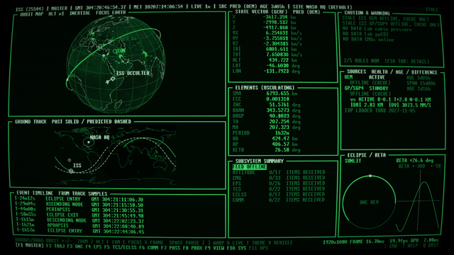
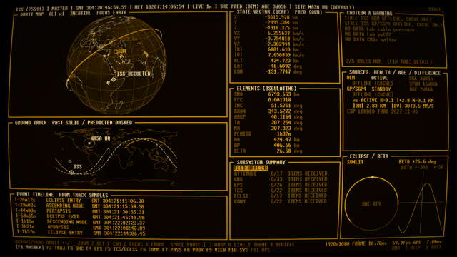
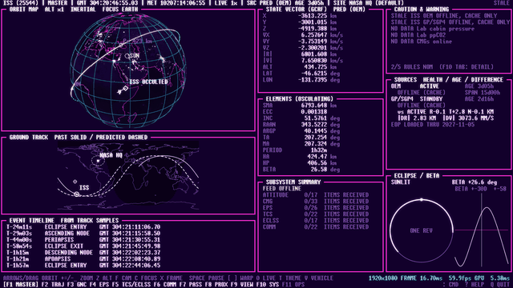
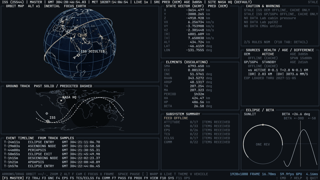
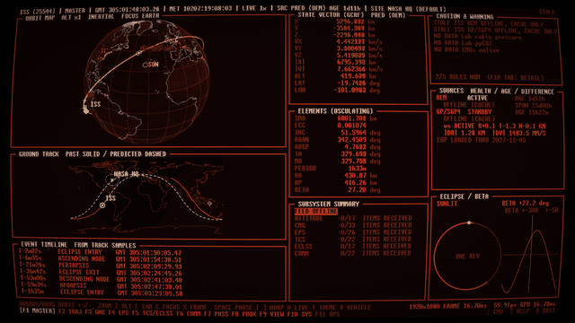
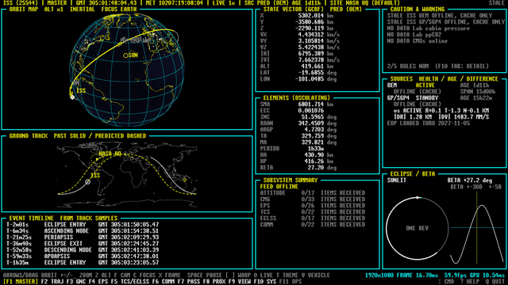
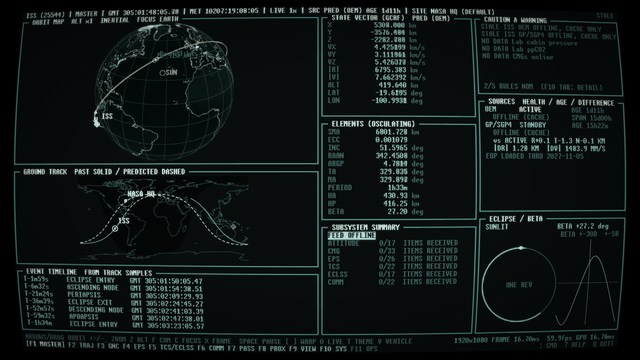
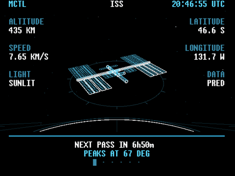

# mctl

mctl is a spacecraft display written in Rust. It follows the ISS, the Crew and Cargo Dragons that visit it,
Hubble, JWST, Roman, the Tiangong station, and Voyager 1 and 2 and New Horizons, and tries to look like a retro flight control room monitor: a 3D orbit map, ground track, sky plot,
pass predictions, a maneuver planner, and live telemetry from the ISS. I wanted something to leave running on
a screen at home.

It's got seven themes (green phosphor, amber, retrowave, a plain dark one, and Soviet red, Teletext and Nostromo teal). It also
has a low-resolution mode for a Raspberry Pi feeding a Commodore 1702 CRT over composite, which is how I run
mine, r/casettefuturism unite!


The themes, on the same page (`T` cycles them):

| | |
|---|---|
|  |  |
|  |  |
|  |  |
|  | |

Full disclaimer, most of the code was written with Claude, Rust is not my expertise but my implementation with Python ran, well, it was seconds per frame rather than frames per second.

Currently mctl has only been really tested in kubuntu and on a Pi 3B+. It runs in Ubuntu under WSL2 on Mesa's software renderer, slowly, and uses X11 there because WSLg's Wayland drops the connection when you resize. YMMV.

## What that display do?

The function keys switch pages and Tab steps through the sub-pages of each one.

- **F1 MASTER**: orbit map, ground track, state vector, elements, event timeline, eclipse and beta angle.
- **F2 TRAJ**: the orbit map and ground track full size, elements and trends from your recording, and the
  maneuver planner.
- **F3 to F6 GNC, EPS, TCS/ECLSS, COMM**: live ISS telemetry, with an attitude indicator, tables and history
  charts.
- **F7 PASS**: sky plot, pass list and observer sites.
- **F8 PROX**: where a visiting vehicle is relative to the station.
- **F9 VIEW**: the Earth out of the vehicle's window (nadir, ram, wake, or look around).
- **F10 SYS**: event log, source health, settings, the caution and warning rules, vehicle facts, line art, and
  the About and Credits pages.
- **F11 OPS**: the JWST and Hubble observing schedules, with a picture of the sky where each is pointed. Requests for pictures sometimes fail, currently under investigation.

## Installing

### A release

Each [release](https://github.com/LiamDroog/mctl/releases) has a tarball for x86-64 and one for aarch64 (a
Raspberry Pi 3 or later running a 64-bit OS), plus checksums. They are built against glibc 2.35, so they need Ubuntu 22.04, Debian 12 or newer. Unpack one and run `./mctl`. If it complains about
a missing library, `packaging/bootstrap.sh` in the tarball works out what's missing and installs it, and
`packaging/install.sh` puts the binary and a desktop entry in `~/.local`. One can also just run `packaging/bootstrap.sh` to install from source, details below.

### From source

On a fresh machine:

```
git clone https://github.com/LiamDroog/mctl
cd mctl
packaging/bootstrap.sh
```

It checks for a C compiler, curl, the libraries the window needs, a Vulkan driver, and Rust 1.95 or newer. It
tells you what's missing, asks, and installs it: system packages through apt, dnf or pacman, and Rust through
the official rustup installer into `~/.cargo` if there's no recent enough one. Then it builds mctl and installs
it into `~/.local`. The first build takes a few minutes on a desktop. Don't do it on a Pi 3; use a release. Unless you've got lots of time, then you do you. I won't tell you how to use your time.

It has a few switches:

```
packaging/bootstrap.sh --check              # just report what's missing, change nothing
packaging/bootstrap.sh --dry-run            # show what it would do
packaging/bootstrap.sh --yes                # don't ask
packaging/bootstrap.sh --no-system-packages # never touch apt/dnf/pacman, only tell me
packaging/bootstrap.sh --prefix /usr/local  # install somewhere else
```

The package names are set for apt (Debian, Ubuntu, Raspberry Pi OS), dnf (Fedora) and pacman (Arch). So far
only apt has been tried on a real machine. If you'd rather do it by hand, you need `build-essential` or the
equivalent, then `cargo build --release --locked -p mctl`.

`packaging/install.sh --uninstall` removes it again. If you're working on the code, `scripts/mctl-launch` is a
launcher that rebuilds before it runs; symlink it as `mctl` somewhere on your `PATH`.

## Using it

```
mctl                            # the console
mctl --vehicle jwst --theme retrowave --fullscreen    # iss, hubble, jwst or roman
mctl --offline                  # use cached data only; nothing is fetched, pictures come from the cache
mctl check                      # check the config and fetch each data source once
mctl about                      # licence, credits, third-party notices
mctl --replay start             # play back your recording (or an ISO time, or an offset like -2h)
mctl --no-record                # don't record this run
mctl export --out ./dump        # every recorded table as CSV
mctl shot --out-dir /tmp/shots --pages all    # headless screenshots, one per theme and page
```

Currently the kiosk/unattended mode only work with the `--kiosk` flag, with simplified layouts and a cycle through the screens. In progress for a regular kiosk mode.

The keys, all of which can be remapped under `[keys]` in the config:

- `F1` to `F11` change page (you can click them in the footer too), `Tab` and `Shift-Tab` change sub-page.
- `T` changes theme, `V` changes vehicle, `?` shows help, `Q` quits.
- `Space` pauses the simulation clock, `[` and `]` halve and double the warp (up to 10000x either way), and
  `0` goes back to live time.
- `A` acknowledges the master caution or warning.
- `:` opens a command line: `warp`, `seek`, `step`, `page`, `theme`, `vehicle`, `site`, `burn`, `plan`,
  `replay` and more. Tab completes.
- On the orbit map, drag to rotate and use the wheel or `+` and `-` to zoom. `X` switches GCRF and ITRF, `Z`
  exaggerates altitude, `F` switches inertial and Earth-fixed, `C` changes focus.
- `1` to `4` toggle the CRT effects and `E` toggles all of them.

Anything that isn't a plain measurement carries a short flag: `[EST]` for estimated, assumed or configured,
`[PLAN]` for scheduled rather than happening, `[TLE]` for derived from a TLE and not trustworthy inside about
5 km, `[SURVEY]` for a sky-survey picture, and `[NOW]` for a current value shown while the clock is somewhere
else. `?` has the legend.

## On a Raspberry Pi and a CRT



`mctl --kiosk` is a second front end on the same engine, built to be looked at rather than driven. It cycles
through the vehicles, with line art, maps, and the console's own pages, and it draws without the CRT
effects because the tube does those itself. It scales to fill whatever screen it is on: the layout is designed for the Pi's 640x480 and a larger screen gets the same layout in bigger text. (`--pi` still works as an alias.) `--size` runs it in a window of that size instead.

```
mctl --kiosk                                       # fullscreen, cycling
mctl --kiosk --kiosk-style dense --theme retrowave    # console pages only, in retrowave
mctl --kiosk --kiosk-order random                  # every scene once per cycle, a new random order each cycle
mctl --kiosk --kiosk-order vehicle --kiosk-vehicles iss,jwst   # one vehicle at a time, in random order
mctl --kiosk --kiosk-order random --kiosk-theme-cycle   # a different random theme with every scene
mctl --kiosk --max-fps 5                           # draw fewer frames to use less CPU (or [display] max_fps)
mctl --kiosk shot --out-dir /tmp/pi                # one PNG per scene
```

The pictures look good on a CRT. The dense console pages are hard to read at that resolution. A Pi 3B+ has no Vulkan GPU, so it renders in software and the frame rate is modest. The setup, the composite output and cross-building for a Pi are in [docs/pi.md](docs/pi.md).

## Live data? Propagated data? Fake data?
mctl pulls live data where available. These contain:

- Element sets: [CelesTrak](https://celestrak.org). It also has a supplemental ISS set that mctl can use but
  doesn't by default.
- ISS trajectory: NASA's public ephemeris. ISS telemetry: the public ISSLIVE feed, over its Lightstreamer
  endpoint. That isn't an official API and it could change or vanish depending what their funding looks like ( :( )
- Earth orientation and leap seconds: IERS and USNO.
- JWST, Roman, Voyager and New Horizons trajectories: [JPL Horizons](https://ssd.jpl.nasa.gov/horizons/).
- JWST visit plans and Hubble reports: [STScI](https://www.stsci.edu).
- Sky pictures: the Digitized Sky Survey (DSS2) through CDS Strasbourg, or, when CDS cannot be reached, the STScI
  copy of it with MAST's name resolver; see the
  [DSS acknowledgement](https://archive.stsci.edu/dss/acknowledging.html).
- The Earth: NASA Earth Observatory's Blue Marble and Black Marble. Coastlines: Natural Earth.
- Fonts: JetBrains Mono and Unscii.

mctl identifies itself in its requests, revalidates with ETags and backs off when something fails. The licences
for the images and fonts it embeds are in [assets/LICENSES.md](assets/LICENSES.md).

## Unfortunately required disclaimers

This is a hobby display. Don't use it for operations, navigation, or anything where being wrong matters. It
isn't affiliated with or endorsed by NASA, ESA, STScI, SpaceX or anyone else whose vehicles or data it shows. If you happen to be in a situation where you're piloting a spacecraft and this is your only means of navigation, please, and I say this lovingly, please reevaluate the chain of decisions that have gotten you into this pickle.

Some specifics about what you're looking at:

- A value with no source says `NO DATA`. I'd rather show nothing than a plausible number.
- The pictures on the OPS page are sky-survey cutouts around the target, not images from Hubble or JWST. The
  schedules are plans, not telemetry; neither observatory publishes telemetry.
- The ISS telemetry has 137 items. A few units the live values disprove are corrected (see
  [docs/attitude-verification.md](docs/attitude-verification.md)), and the attitude convention is
  an assumption that the page says so about. The caution and warning limits for ISS subsystems are my own
  placeholders, not flight rules.
- Pass times match an independent implementation of mine to a few milliseconds
  ([docs/pass-verification.md](docs/pass-verification.md)). They haven't been compared with a
  published predictor like Heavens-Above.
- The maneuver planner integrates numerically (DOP853, J2 to J4, Sun and Moon, atmospheric drag, optional solar
  pressure). Against NASA's ISS ephemeris it's 3.1 km off after a day with no drag, and 7.3 km off with the
  simple drag model, so the drag scale is a setting you can adjust.
- PROX comes from TLEs. When a Dragon is docked, CelesTrak gives it the station's own element set, so it reads
  DOCKED. The keep-out sizes are assumptions.
- The window view has the right limb curvature for the altitude, but the Earth is a still picture with no
  clouds.

## Configuration and files

The defaults are built in (`config/default.toml`). A file at `~/.config/mctl/config.toml` overrides any key,
and a bad value stops the program with an error rather than being ignored. Downloaded data is cached in
`~/.cache/mctl`, logs go to `~/.local/state/mctl/mctl.log`, and your recording is
`~/.local/share/mctl/mctl.db`, a SQLite file kept for 30 days or 2 GB. Only real time is recorded, never
simulated states.

For passes, the observer site is the one you configure, otherwise GeoClue if your system allows it, otherwise a
built-in NASA HQ fallback. There's also an IP lookup, which is off unless you switch it on and is the only thing
that would send anything about you anywhere. There's no telemetry or analytics. I don't really give a damn about who's using this. Unless you do happen to be in a situation where you're piloting a spacecraft with this software. Please let me know about that. If you survive.

## Contributing

Bug reports and pull requests are welcome; [CONTRIBUTING.md](CONTRIBUTING.md) has the details. For security
problems, see [SECURITY.md](SECURITY.md). [docs/architecture.md](docs/architecture.md) is a tour of how the code
fits together, and the crates are:

- `mctl-core`: time, state, config, the world snapshot, source arbitration, caution and warning rules.
- `mctl-astro`: SGP4, ephemerides, frames, Sun and Moon, passes, the numerical propagator.
- `mctl-sources`: the HTTP cache, fetch threads, the ISSLIVE client, schedules, sky pictures, observer location.
- `mctl-sim`: the engine, the simulation clock, the planner.
- `mctl-store`: the SQLite recording.
- `mctl-gui`: the console, the pages, the themes, the Pi display.

## Credits and licence

I credit the copious amout of synthwave and retrowave music and the desire for a retrofuturistic (Hi, r/casettefuturism!) display piece in my home. The idea, the design, the testing and the Pi and CRT setup are mine; Claude wrote much of the
code and the documentation from that as was previously mentioned. Thanks to the people who keep CelesTrak, Horizons, the IERS, STScI and
NASA's public data services running. `mctl about` prints the full credits, and the third-party notices are in
[THIRD-PARTY-NOTICES.md](THIRD-PARTY-NOTICES.md). Anyone ~crazy~ kind enough to contribute to the repo will also be acknowledged here.

mctl is free software under the GNU General Public License, version 3 or (at your option) any later version.
See [LICENSE](LICENSE). Please don't sell this. If you want to use it in any published media (short/long form) please contact me before use.
