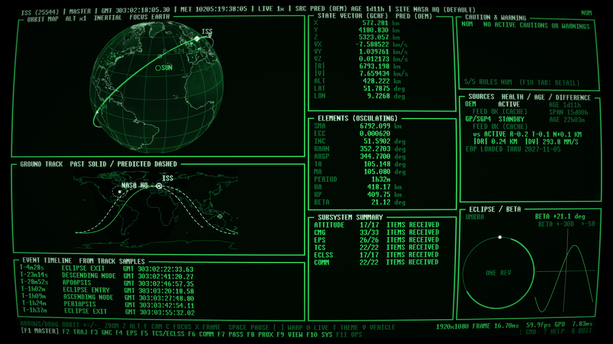

# mctl

A mission-control display for the ISS and the spacecraft around it, in the style of a flight control console:
live orbits, ground tracks, sky plots and pass predictions, ISS telemetry with caution-and-warning rules, a
maneuver planner, replay of what you recorded, and JWST and Hubble observing schedules with pictures of what
they are pointed at. It runs as a native Rust program on Linux, with four colour themes (green and amber
phosphor, a modern slate, retrowave), and it has a low-resolution mode for a Raspberry Pi driving a
composite CRT.



**Status:** early (0.x). Linux only: Wayland or X11, with a Vulkan driver (a software one such as Mesa's
lavapipe is enough, just slow). It is built and used on one desktop and one Raspberry Pi 3B+; other hardware
is untested. Windows and macOS are not supported.

## Vehicles and pages

ISS, Hubble, JWST and Roman, plus the Crew and Cargo Dragons that visit the station. JWST and Roman are
followed at the Sun-Earth L2 point. `F1`-`F11` switch pages and `Tab` steps through sub-pages:

| Page | Shows |
|---|---|
| MASTER | 3D orbit map, ground track, state vector, elements, event timeline, eclipse and beta angle, C&W summary |
| TRAJ | orbit map, ground track, elements and trends from the recording, maneuver planner |
| GNC, EPS, TCS/ECLSS, COMM | live ISS telemetry (ISSLIVE): attitude indicator, tables, history sparklines |
| PASS | sky plot, pass list and observer sites |
| PROX | R-bar/V-bar motion of a visiting vehicle about the station |
| VIEW | the Earth from the vehicle's window: nadir, ram, wake or free look |
| SYS | event log, source health, settings, C&W rules, vehicle facts and line art |
| OPS | JWST and Hubble observing schedules, with survey pictures of the current and next target |

## Install

Prebuilt Linux binaries (x86-64, and aarch64 for a Raspberry Pi) are attached to each
[release](https://github.com/LiamDroog/mctl/releases) with checksums. The binary embeds its configuration,
fonts, textures and coastlines, and needs only a GPU driver and libc.

To build from source you need Rust 1.95 or newer:

```
cargo build --release --locked -p mctl
./target/release/mctl            # the console
```

`packaging/install.sh` builds a release binary and installs it with desktop entries and an icon
(`--prefix`, `--uninstall`). `scripts/mctl-launch` is a development launcher that rebuilds before running;
symlink it as `mctl` somewhere on your `PATH`.

## Using it

```
mctl                             # the console
mctl --vehicle jwst --theme retrowave --fullscreen   # iss | hubble | jwst | roman (or V in the console)
mctl --offline                   # cached data only, no network
mctl check                       # validate the config, fetch every source once, report
mctl about                       # licence, credits and third-party notices
mctl --replay start              # play back the recording (start, an ISO epoch, or an offset such as -2h)
mctl --no-record                 # do not record this run
mctl isslive --duration-s 30     # print live ISS telemetry
mctl export --out ./dump         # every recorded table as CSV (or: export telemetry --from ... --out t.csv)
mctl shot --out-dir /tmp/shots --pages all   # headless PNGs, one per theme and page (page or page:sub)
tools/smoke.sh                   # render every page headless and check the images
```

Keys (all single-character keys are remappable under `[keys]` in the config): `F1`-`F11` pages (clickable in
the footer), `Tab`/`Shift-Tab` sub-pages, `T` theme, `V` vehicle, `Space` pause/resume the simulation clock,
`[` `]` halve/double the warp (up to 10000x either way), `0` back to LIVE, `A` acknowledge the master
caution/warning, `:` command line (`warp`, `seek`, `step`, `page`, `theme`, `vehicle`, `fx`, `ack`, `site`,
`burn`, `plan`, `replay`, ...; `Tab` completes), `?` help, `Q` quit. `W` cycles the trends window. On the
orbit map, drag to rotate and use the wheel or `+`/`-` to zoom; `X` GCRF/ITRF, `Z` altitude exaggeration,
`F` inertial/Earth-fixed, `C` focus; `1`-`4` toggle the CRT effects and `E` all of them. The window view
(`F9`) is steered by dragging or the arrow keys in free look.

Values that are not plain measurements carry a short flag: `[EST]` estimated, assumed, inferred or
configured; `[PLAN]` scheduled, not what is happening; `[TLE]` TLE-derived, not valid inside about 5 km;
`[SURVEY]` a sky-survey cutout, not an observatory image; `[NOW]` the current value while the clock is not at
the present. The legend is in `?` help.

## Raspberry Pi and CRT

`mctl --pi` is a second front end for the same engine, made to be looked at: big line art, maps and the
console's own pages at 640x480, cycling through the vehicles, with no effects (the tube supplies those). It
runs on a Pi 3B+ (which has no Vulkan GPU, so it uses software rendering and the frame rate is modest) and
on anything faster.

```
mctl --pi                                      # fullscreen display
mctl --pi --pi-style dense --theme retrowave   # console pages only, in the retrowave colours
mctl --pi shot --out-dir /tmp/pi               # one PNG per scene
```

Setup, composite output, cross-building and the systemd service are in [docs/pi.md](docs/pi.md).

## Configuration and data

Defaults are embedded (`config/default.toml`); a file at `~/.config/mctl/config.toml` overrides any key, and
invalid values fail loudly. Downloaded data is cached in `~/.cache/mctl`, logs go to
`~/.local/state/mctl/mctl.log`, and the recording is `~/.local/share/mctl/mctl.db` (SQLite; retention 30 days
or 2 GB, set under `[store]`). Only real time is recorded, never simulated states. C&W rules are `[[rule]]`
entries; the ISS subsystem ones are illustrative, not flight rules.

The observer site for pass predictions is the configured one, else GeoClue (if your system allows it), else
(off by default) an IP lookup, else a built-in NASA HQ fallback. The IP lookup is the only thing that sends
anything about you anywhere, and it is off unless you turn it on. There is no telemetry or analytics.

## What is real

Every number on the MASTER page comes from a source: CelesTrak GP elements (SGP4) and the NASA ISS ephemeris
through an arbiter, IERS earth-orientation data, and an analytic Sun and Moon. A quantity with no source reads
`NO DATA`. JWST and Roman come from JPL Horizons; Hubble uses CelesTrak with Horizons as a cross-check. The
OPS page shows the JWST weekly visit plan and the Hubble daily programme list from STScI; both are plans, not
engineering telemetry, which neither observatory publishes. Its pictures are DSS2 sky-survey cutouts around
the target, not Hubble or JWST images.

ISS telemetry (137 ISSLIVE items) feeds GNC/EPS/TCS/COMM. Some units the live values disprove are corrected
([notes](docs/step3/attitude-verification.md)), and the attitude convention is an assumption the page says so
about. Pass times match an independent implementation to milliseconds
([check](docs/step4/pass-verification.md)) but have not been compared with a published predictor. The
maneuver planner propagates numerically (DOP853, J2-J4, Sun and Moon, exponential-atmosphere drag, optional
solar radiation pressure); against the NASA ISS ephemeris it is 3.1 km off after a day without drag, and
7.3 km with the static drag model, so the drag scale is a control. PROX is TLE-derived: while a Dragon is
docked CelesTrak gives it the station's own element set, so it reads DOCKED, and the keep-out sizes are
configured assumptions. The window view has the right limb curvature for the altitude, but the Earth is a
static picture without clouds.

**mctl is a hobby display, not an operational tool. Do not use it for anything safety-critical, for
navigation, or to decide anything about a real spacecraft.** It is not affiliated with or endorsed by NASA,
ESA, STScI, SpaceX or any other organisation whose vehicles or data it shows.

## Data sources and credits

| Data | From |
|---|---|
| Element sets (GP/OMM), supplemental GP | [CelesTrak](https://celestrak.org) |
| ISS trajectory (OEM) | NASA's public ISS trajectory data |
| ISS telemetry | NASA's public ISSLIVE feed, over its Lightstreamer endpoint. It is not an official API and can change or disappear |
| Earth orientation, leap seconds | IERS / USNO finals2000A |
| JWST and Roman trajectories | [JPL Horizons](https://ssd.jpl.nasa.gov/horizons/) |
| JWST visit plans, Hubble reports and programs | [STScI](https://www.stsci.edu) |
| Survey pictures | the Digitized Sky Survey (DSS2) through [CDS](https://cds.unistra.fr) Sesame and hips2fits; see the [DSS acknowledgement](https://archive.stsci.edu/dss/acknowledging.html) |
| Earth day texture | NASA Earth Observatory, Blue Marble Next Generation (R. Stöckli) |
| Earth night lights | NASA Earth Observatory / NOAA NGDC, Black Marble 2012 (Suomi NPP VIIRS) |
| Coastlines | [Natural Earth](https://www.naturalearthdata.com) (public domain) |
| Fonts | JetBrains Mono (SIL OFL 1.1) and Unscii (public domain) |

mctl fetches these politely: it identifies itself with a User-Agent, revalidates with ETags and backs off after
failures. The embedded assets and their licences are listed in [assets/LICENSES.md](assets/LICENSES.md).

## Layout

| | |
|---|---|
| `crates/mctl-core` | time, state, config, the world snapshot, the bus, source arbitration, C&W rules |
| `crates/mctl-astro` | SGP4, OEM, frames, Sun and Moon, elements, events, passes, the numerical propagator, Horizons |
| `crates/mctl-sources` | HTTP cache, supervised fetch threads, the ISSLIVE client, schedules, survey pictures, observer location |
| `crates/mctl-sim` | the 50 Hz engine, the simulation clock, planner, passes and trends workers |
| `crates/mctl-store` | SQLite recording and export |
| `crates/mctl-gui` | the console renderer (winit, wgpu, egui), pages, themes, art, the Pi display |
| `crates/mctl-tui` | a placeholder for a future text front end |
| `src/` | the `mctl` binary |
| `spikes/` | the early throwaway prototypes, kept for reference |

[docs/architecture.md](docs/architecture.md) explains how the pieces fit together.

## Contributing

Bug reports and pull requests are welcome; see [CONTRIBUTING.md](CONTRIBUTING.md). Security issues:
[SECURITY.md](SECURITY.md).

## Licence

mctl is free software under the **GNU General Public License, version 3 or (at your option) any later
version** (see [LICENSE](LICENSE)). The dependencies are permissive or compatible; their notices are in
[THIRD-PARTY-NOTICES.md](THIRD-PARTY-NOTICES.md) and are printed by `mctl about`.
